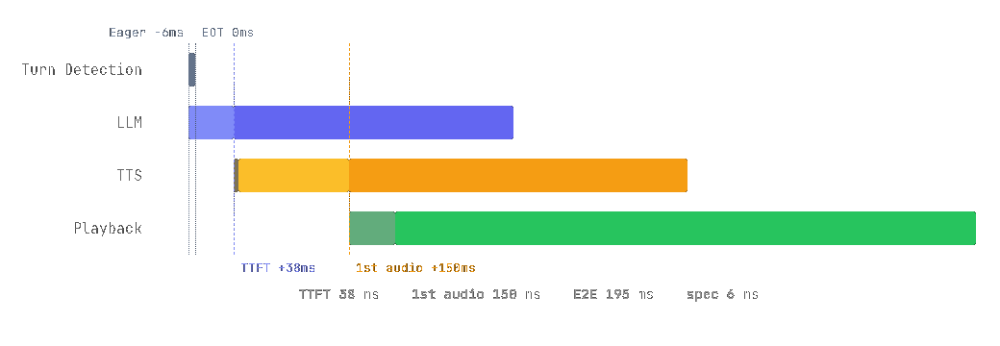

# Iris Voice Agent

Real-time voice agent on Cloudflare Workers + Durable Objects. ~150ms to first audio.

**Try it:** [aa0.dev/voice-agent](https://aa0.dev/voice-agent)

## Demo

https://github.com/user-attachments/assets/36c7fafc-f8fd-4d34-9578-66880b697a25

## Overview

The whole pipeline runs in parallel. Deepgram handles speech-to-text and turn detection, Groq generates the response, and ElevenLabs (or Orpheus, or Aura 2) synthesises speech. These three stages overlap: the LLM starts streaming while the transcript is still finalising, and TTS begins as soon as the first clause arrives from the LLM.



To cut latency further, the agent starts generating speculatively at ~30% end-of-turn confidence from Deepgram. If the final transcript matches, it commits and the user hears the response almost immediately. If the user keeps talking, it aborts and retries with the corrected transcript.

Audio is raw PCM over WebSocket (no base64 JSON wrapping), and leading silence is trimmed from TTS output so there's no dead air before the agent starts speaking.

Tool calls (adding items to a cart, looking up an order, making a reservation) run on a separate background lane. The main agent keeps talking while tools execute in parallel, and results are compressed before being injected back into context.

Interruption is instant. VAD detects speech and everything in-flight aborts.

## Scenarios

- **Drive-thru**: order from a menu, items tracked in a cart
- **Restaurant booking**: make, update, or cancel reservations
- **Customer support**: check orders, start returns, update shipping

## Stack

Cloudflare Workers + Durable Objects, Deepgram (STT + turn detection), Groq (LLM), ElevenLabs / Together Orpheus / Workers AI Aura 2 (TTS). Frontend is plain HTML/CSS/JS.

## Setup

```bash
pnpm install
cp .dev.vars.example .dev.vars  # add your API keys
pnpm dev:local
```
